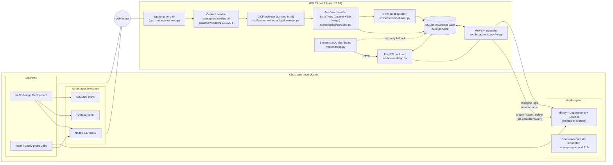
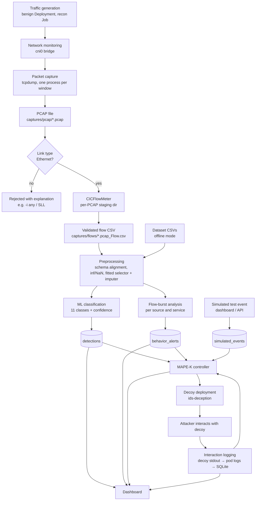

# Architecture

## 1. Component architecture

Isolation and least privilege:

* `ids-traffic` egress is limited by NetworkPolicy to the three target ports, the decoy port and DNS.
* Decoys accept ingress only from `ids-traffic` / `target-apps` and have **no** egress (`egress: []`).
* Decoy pods: non-root UID 65534, read-only root filesystem, all capabilities dropped, no privilege
  escalation, no service-account token, no host namespaces or hostPath, `restricted` Pod Security level.
* The backend uses the `ids-controller` service account: write access only to Deployments/Services in
  `ids-deception`, read-only access to the lab namespaces, nodes and the namespace list. No cluster-admin.

## 2. System workflow

Processing is window-based: a detection appears one window (5–30 s) plus the measured pipeline time
(< 1 s) after the traffic, not packet by packet.

## 3. MAPE-K loop

```mermaid
flowchart LR
    subgraph M["Monitor"]
        m1["new ML detections<br/>(malicious, act_on_sources)"]
        m2["new flow bursts"]
        m3["new simulated events"]
        m4["decoy status (K8s)"]
        m5["decoy interactions (pod logs)"]
    end
    subgraph A["Analyze"]
        a1["group by source + class"]
        a2["confidence ≥ 0.9 → high"]
        a3["≥ 0.6 → medium: needs ≥ 3 detections<br/>in 300 s or a corroborating burst"]
        a4["< 0.6 → low: monitor<br/>benign → never deploy"]
    end
    subgraph P["Plan"]
        p1["class / burst port → decoy profiles<br/>(config policy)"]
        p2["order profiles by past engagement"]
        p3["deploy · scale · refresh TTL<br/>suppress: limit / cooldown"]
    end
    subgraph E["Execute"]
        e1["create Deployment + Service<br/>from predefined template"]
        e2["scale replicas"]
        e3["remove expired / manual"]
    end
    subgraph K["Knowledge (SQLite)"]
        k1["decisions + reasons + evidence"]
        k2["decoy lifecycle + deploy time"]
        k3["interactions"]
    end
    M --> A --> P --> E --> K
    K -->|"engagement reorders profiles,<br/>extends TTL, drives density"| P
    K -->|"history for repeat checks"| A
```

Housekeeping (status reconciliation, readiness and deployment time, interaction collection, TTL expiry,
engagement-based scaling) runs every cycle even when automatic deception is disabled. The ML model is
never retrained from decoy interactions.
